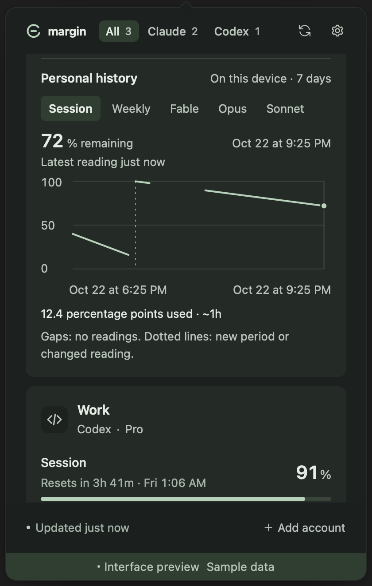
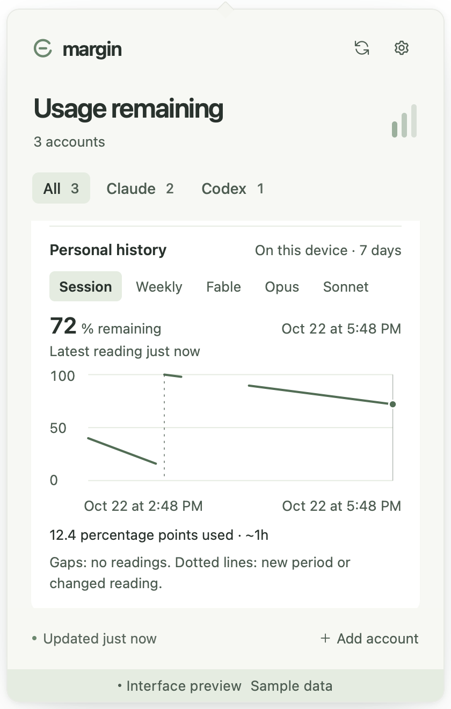

# Margin

**Claude Code and OpenAI Codex usage monitor for macOS and Windows.**

See remaining quota and reset times across multiple accounts, right from your menu bar or system tray.

[](https://github.com/Abulkosim/margin/actions/workflows/ci.yml)
[](LICENSE)
[](https://scorecard.dev/viewer/?uri=github.com/Abulkosim/margin)

[Download](https://github.com/Abulkosim/margin/releases/latest) · [Install](#install) · [Connect accounts](#connect-accounts) · [Privacy](#privacy) · [Changelog](CHANGELOG.md) · [Develop](#develop)

<p>
  
  
</p>

Browser previews with sample accounts. [Settings preview](docs/images/settings-light.png).

<p>
  
  
</p>

Settings menus with sample data.

<p>
  
  
</p>

Usage history with sample data.

## What it does

- **Multiple accounts:** discover existing CLI sign-ins or add a configuration folder for each account.
- **Usage:** remaining percentages and reset countdowns for reported session, weekly, and model-specific windows. Extra-usage spend appears when Claude reports it.
- **Tray indicator:** follow a pinned account or the account with the least remaining quota.
- **Last known usage:** keep the last successful reading with its age when a request fails. Missing data stays unknown.
- **Usage history:** open History on an account to see remaining quota over time. Readings stay on this device for up to seven days; gaps and new quota periods stay visible.
- **Updates on request:** check for new releases in Settings, then install and restart when you choose. Downloads and versions are verified before installation.
- **Settings:** light, dark, or system theme; configurable polling; optional threshold notifications and launch at login.

[v0.3.0](https://github.com/Abulkosim/margin/releases/tag/v0.3.0) adds local usage history, larger text, and clearer percentages in both themes. macOS and Windows [release checks](https://github.com/Abulkosim/margin/actions/runs/39058156374) passed. See the [changelog](CHANGELOG.md) and [verification record](docs/verification.md).

## Install

Download **v0.3.0** from [GitHub Releases](https://github.com/Abulkosim/margin/releases/latest). Homebrew and winget are not available yet. Step-by-step guide with uninstall: [docs/install.md](docs/install.md).

| Platform | Download |
| --- | --- |
| macOS 12+ · Apple Silicon and Intel | [Universal DMG](https://github.com/Abulkosim/margin/releases/download/v0.3.0/Margin_0.3.0_universal.dmg) |
| Windows x64 | [Setup EXE](https://github.com/Abulkosim/margin/releases/download/v0.3.0/Margin_0.3.0_x64-setup.exe) · [MSI](https://github.com/Abulkosim/margin/releases/download/v0.3.0/Margin_0.3.0_x64_en-US.msi) |

Builds are not signed with an Apple Developer ID or Windows publisher certificate, so the first launch shows a warning. Updates are signed and verified in the app.

To run from source, see [Develop](#develop).

### macOS

Drag Margin to Applications and open it. On macOS 15 and later, when **“Margin” Not Opened** appears, click **Done**, then open **System Settings → Privacy & Security → Open Anyway** and confirm with **Open**. Control-click → Open no longer works there. Margin has no Dock icon; it lives in the menu bar. [Details and fallback](docs/install.md#macos).

### Windows

Run the `-setup.exe` (or `.msi`). On **Windows protected your PC**, click **More info → Run anyway**. Smart App Control blocks unsigned apps with no per-app exception. [Details, Smart App Control, and antivirus warnings](docs/install.md#windows).

### Verify a download

Compare checksums with `SHA256SUMS.txt`, and on releases after v0.3.0 check the build attestation:

```sh
gh attestation verify Margin_<version>_universal.dmg --repo Abulkosim/margin
```

See [docs/install.md](docs/install.md#verify-a-download) for both platforms.

### Updates

Margin checks for updates daily; turn this off or check by hand in **Settings → General → Updates**. Installing is always your choice. v0.1.1 and earlier: install the latest release once by hand. [Details](docs/install.md#updates).

## Connect accounts

Sign in through Claude Code or Codex first. Margin reads those existing OAuth credentials; API-key-only accounts are unsupported. Add each extra configuration folder in Settings; keep each account in its own folder.

| Provider | Default credentials | Custom configuration |
| --- | --- | --- |
| Claude | `~/.claude/.credentials.json`; macOS `Claude Code-credentials` Keychain item as fallback | `CLAUDE_CONFIG_DIR` or an added folder; macOS `Claude Code-credentials-<suffix>` Keychain item |
| Codex | `~/.codex/auth.json` | `CODEX_HOME` or an added folder |

To run a second Claude account, start Claude Code with its own folder and sign in:

```sh
CLAUDE_CONFIG_DIR=~/.claude-work claude
```

Margin finds `~/.claude-work` automatically; for a folder elsewhere, add it in Settings. On macOS, the token stays in Keychain and Margin reads the item for that folder.

Discovery also checks home dotfolders containing `claude` or `codex`. It deduplicates configuration paths. On Windows, `~` means your user profile folder. Apps launched from Finder or the Start menu may not inherit terminal environment variables; add custom folders in Settings if needed.

An expired token or failed request leaves the last successful reading visible with its age and stale state. No reading means no percentage. Sign in again through the relevant CLI, then refresh Margin. For a custom Codex account, run `codex login` with that account's `CODEX_HOME` set. Claude usage requires the `user:profile` OAuth scope; inference-only tokens cannot read it.

Provider usage endpoints are undocumented and may change. A quota displayed here is a reading from the provider, not a guarantee that the next request will be accepted.

## Privacy

Credentials and provider requests remain in Rust. The interface receives account details and usage snapshots, never tokens. App settings, last-known usage, and usage history are stored locally; they can include account emails and folder paths.

History starts with new successful readings; it cannot recover usage from before Margin was running. It records at most once a minute within a continuous quota period, with up to seven days or 10,000 window readings per account, whichever fits first. Offline periods and failed readings appear as gaps. Removing an account also removes its local history. History uses the existing refresh schedule and makes no additional provider requests.

Margin does not write to CLI credential files, rotate CLI tokens, read browser cookies, change active accounts, or spend reset credits. No Margin account or hosted backend is required. Explicit update checks contact GitHub Releases without sending CLI credentials, account identities, or usage readings.

See [PRIVACY.md](PRIVACY.md) for exact files, Keychain items, and hosts. Report vulnerabilities as described in [SECURITY.md](SECURITY.md).

## Develop

To run from source, preview the interface with sample data, or run the tests, see [CONTRIBUTING.md](CONTRIBUTING.md).

## Contribute

[Report a bug](https://github.com/Abulkosim/margin/issues/new/choose) with the version, operating system, display scaling, and reproduction steps. Redact account details in screenshots; never attach tokens or credential files. Provider parsing changes should include a fixture and a regression test.

The project stays focused on Claude and Codex. Planned: explicit account activation with confirmation and backup, and local cost history. Independent OAuth login remains deferred until the provider's current public client details are verified.

Inspired by [CodexBar](https://github.com/steipete/CodexBar), with a focused provider set and a shared macOS/Windows codebase. Margin is an independent project, unaffiliated with Anthropic or OpenAI.

[MIT](LICENSE)
