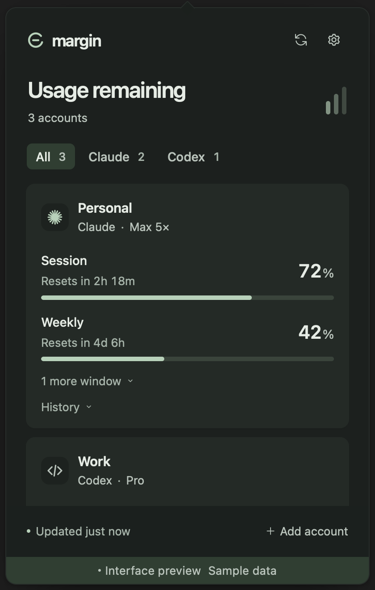
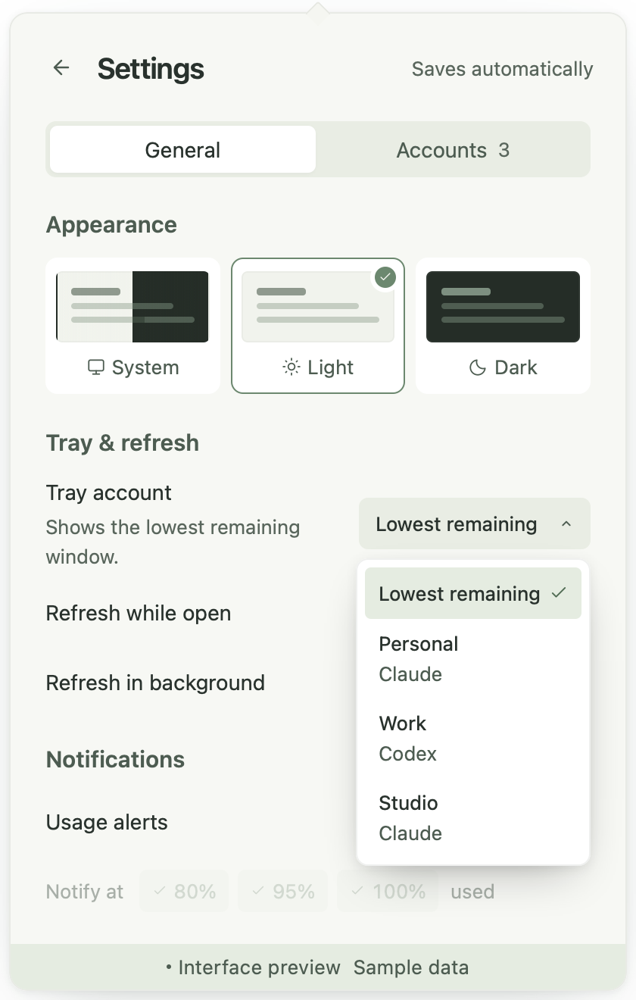
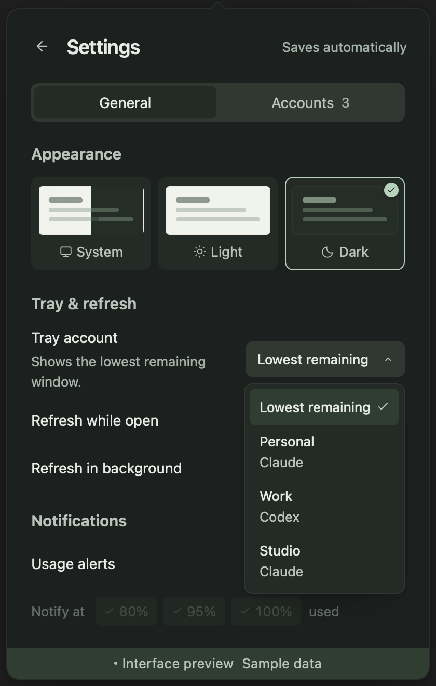

# Margin

**Claude Code and OpenAI Codex usage monitor for macOS and Windows.**

See remaining quota and reset times across multiple accounts, right from your menu bar or system tray.

[](https://github.com/Abulkosim/usagebar/actions/workflows/ci.yml)
[](LICENSE)

[Download](https://github.com/Abulkosim/usagebar/releases/latest) · [Install](#install) · [Connect accounts](#connect-accounts) · [Privacy](#privacy) · [Develop](#develop)

<p>
  
  
</p>

Browser previews with sample accounts. [Settings preview](docs/images/settings-light.png).

<p>
  
  
</p>

v0.1.1 settings previews with sample data.

## What it does

- **Multiple accounts:** discover existing CLI sign-ins or add a configuration folder for each account.
- **Quota at a glance:** remaining percentages and reset countdowns for reported session, weekly, and model-specific windows. Extra-usage spend appears when Claude reports it.
- **One quiet tray indicator:** follow a pinned account or the account with the least remaining quota.
- **Honest stale states:** keep the last successful reading with its age when a request fails. Missing data stays unknown.
- **Your preferences:** light, dark, or system theme; configurable polling; optional threshold notifications and launch at login.

The published v0.1.1 release includes styled Reka UI controls and passed 48 browser tests across Chromium and WebKit. The packaged Mac app was verified locally; macOS universal and Windows x64 builds passed [release CI](https://github.com/Abulkosim/usagebar/actions/runs/38848296438). Interactive Windows testing remains planned in a VM; see [verification status](docs/verification.md).

## Install

Download **v0.1.1** from [GitHub Releases](https://github.com/Abulkosim/usagebar/releases/latest).

| Platform | Download |
| --- | --- |
| macOS 12+ · Apple Silicon and Intel | [Universal DMG](https://github.com/Abulkosim/usagebar/releases/download/v0.1.1/Margin_0.1.1_universal.dmg) |
| Windows x64 | [Setup EXE](https://github.com/Abulkosim/usagebar/releases/download/v0.1.1/Margin_0.1.1_x64-setup.exe) · [MSI](https://github.com/Abulkosim/usagebar/releases/download/v0.1.1/Margin_0.1.1_x64_en-US.msi) |

To run from source, see [Develop](#develop).

### macOS

Use the universal `.dmg` on Apple Silicon or Intel with macOS 12 or later. Open it, move Margin to Applications, then launch Margin.

Early releases are ad-hoc signed, without an Apple developer signature or notarization. On older macOS versions, right-click Margin → **Open**. If macOS blocks it, open **System Settings → Privacy & Security → Open Anyway** after the first launch attempt. Follow [Apple's guidance](https://support.apple.com/en-us/102445); managed Macs may prohibit exceptions.

### Windows

Use the x64 `-setup.exe` installer, or `.msi` for Windows Installer. WebView2 is required; the [installer downloads its setup program](https://v2.tauri.app/distribute/windows-installer/#downloaded-bootstrapper) when needed, so first installation may need internet access.

Early releases have no verified publisher signature. If SmartScreen shows its reputation warning, choose **More info → Run anyway** after checking the download source. A managed device may disable this option. See [Microsoft's SmartScreen overview](https://learn.microsoft.com/en-us/windows/security/operating-system-security/virus-and-threat-protection/microsoft-defender-smartscreen/).

Each release includes `SHA256SUMS.txt`. Compare the downloaded installer's checksum with that file using `shasum -a 256 <file>` on macOS or `Get-FileHash <file> -Algorithm SHA256` in PowerShell.

## Connect accounts

Sign in through Claude Code or Codex first. Margin reads those existing OAuth credentials; API-key-only accounts are unsupported. Add each extra configuration folder in Settings; keep each account in its own folder.

| Provider | Default credentials | Custom configuration |
| --- | --- | --- |
| Claude | `~/.claude/.credentials.json`; macOS `Claude Code-credentials` Keychain item as fallback | `CLAUDE_CONFIG_DIR` or an added folder |
| Codex | `~/.codex/auth.json` | `CODEX_HOME` or an added folder |

Discovery also checks home dotfolders containing `claude` or `codex`. It deduplicates configuration paths. On Windows, `~` means your user profile folder. Apps launched from Finder or the Start menu may not inherit terminal environment variables; add custom folders in Settings if needed.

An expired token or failed request leaves the last successful reading visible with its age and stale state. No reading means no percentage. Sign in again through the relevant CLI, then refresh Margin. For a custom Codex account, run `codex login` with that account's `CODEX_HOME` set. Claude usage requires the `user:profile` OAuth scope; inference-only tokens cannot read it.

Provider usage endpoints are undocumented and may change. A quota displayed here is a reading from the provider, not a guarantee that the next request will be accepted.

## Privacy

Credentials and provider requests remain in Rust. The interface receives account details and usage snapshots, never tokens. App settings and last-known usage are stored locally; they can include account emails and folder paths.

Margin does not write to CLI credential files, rotate CLI tokens, read browser cookies, change active accounts, or spend reset credits. No Margin account or hosted backend is required.

## Preview the interface

Requires Node.js 24 and pnpm 11.25.0.

```sh
pnpm install --frozen-lockfile
pnpm dev
```

Append `?demo=1` to the local URL printed by Vite. This previews clearly labeled sample accounts without reading credentials or making provider requests. The plain URL shows a desktop-app entry screen. The [design study](design/directions.html) explores the initial visual directions.

## Develop

Built with Tauri 2, Rust, Vue 3, Reka UI, TypeScript, and Vite. Install Node.js 24, pnpm 11.25.0, [Tauri's platform prerequisites](https://v2.tauri.app/start/prerequisites/), and stable Rust with [rustup](https://rustup.rs). macOS needs Xcode Command Line Tools. Windows needs Microsoft C++ Build Tools with Desktop development with C++ and WebView2.

```sh
pnpm install --frozen-lockfile
pnpm tauri dev
```

Run the checks:

```sh
pnpm build
pnpm test
pnpm exec playwright install chromium webkit
pnpm test:e2e
cargo fmt --manifest-path src-tauri/Cargo.toml --all -- --check
cargo clippy --manifest-path src-tauri/Cargo.toml --all-targets --locked -- -D warnings
cargo test --manifest-path src-tauri/Cargo.toml --locked
```

`pnpm build` includes TypeScript checks and produces the frontend assets required by native Rust checks. Browser tests cover the preview interface; native behavior needs the [platform smoke checks](docs/verification.md#native-smoke-checks). Provider tests use [synthetic and sanitized live-schema fixtures](src-tauri/fixtures/README.md), without credentials or network requests.

Build an installer on the target OS with `pnpm tauri build`. The [release workflow](.github/workflows/ci.yml) builds macOS universal and Windows x64 installers and drafts releases on `v*` tags. Follow the [release runbook](docs/releasing.md) before tagging.

## Contribute

[Report a bug](https://github.com/Abulkosim/usagebar/issues/new/choose) with the version, operating system, display scaling, and reproduction steps. Redact account details in screenshots; never attach tokens or credential files. Provider parsing changes should include a fixture and a regression test.

The project stays focused on Claude and Codex. Planned: signed updates, explicit account activation with confirmation and backup, burndown history, and local cost history. Independent OAuth login remains deferred until the provider's current public client details are verified.

Inspired by [CodexBar](https://github.com/steipete/CodexBar), with a focused provider set and a shared macOS/Windows codebase. Margin is an independent project, unaffiliated with Anthropic or OpenAI.

[MIT](LICENSE)
