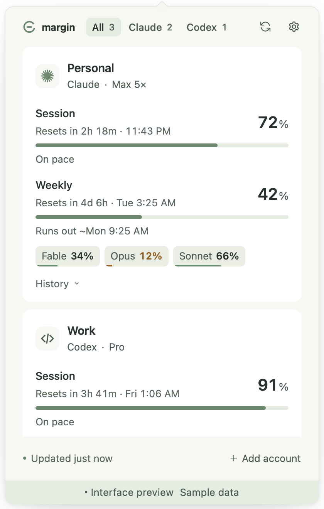
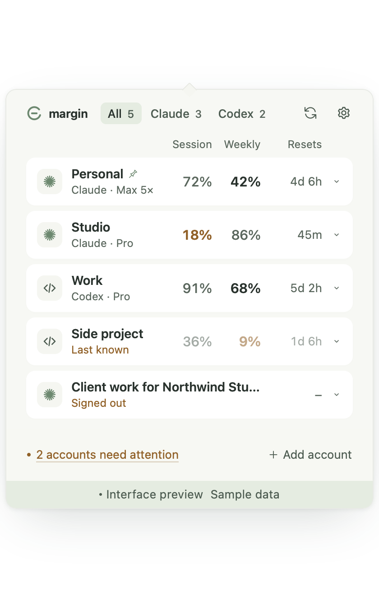
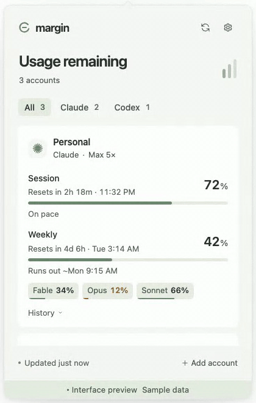

# Margin

**Claude Code and Codex usage in your menu bar.** See remaining quota and reset times across multiple accounts, from the macOS menu bar or the Windows system tray.

[](https://github.com/Abulkosim/margin/actions/workflows/ci.yml)
[](https://github.com/Abulkosim/margin/releases/latest)
[](https://github.com/Abulkosim/margin/releases)
[](docs/install.md)
[](LICENSE)
[](https://scorecard.dev/viewer/?uri=github.com/Abulkosim/margin)

[Download](https://github.com/Abulkosim/margin/releases/latest) · [Install](#install) · [Connect accounts](#connect-accounts) · [Privacy](#privacy) · [Changelog](CHANGELOG.md) · [Contributing](CONTRIBUTING.md)

<p>
  
  
</p>

Interface preview with sample data; real menu-bar screenshots to follow.

<p></p>

## What it shows

- **Many accounts at once.** Finds existing Claude Code and Codex sign-ins, including separate configuration folders; add more in Settings.
- **Session, weekly, and model limits.** Usage remaining, reset countdown and time, and a pace line: "On pace", or when usage runs out at the current rate.
- **Last-known values, labeled.** A failed request keeps the last reading with its age. Missing data stays unknown, never guessed.
- **Alerts.** Notifications at thresholds you choose (50–100%), and optionally when a limit resets.

## Why Margin

|  | Margin | [CodexBar](https://github.com/steipete/CodexBar) | [Claude Usage Tracker](https://github.com/hamed-elfayome/Claude-Usage-Tracker) | Claude Code `/usage`, Codex `/status` |
| --- | :-: | :-: | :-: | :-: |
| macOS | ✓ | ✓ | ✓ | ✓ |
| Windows | ✓ | – | – | ✓ |
| Multiple accounts | ✓ | ✓ | ✓ | – |
| Claude and Codex together | ✓ | ✓ | ✓ | – |
| OAuth only, no browser cookies | ✓ | – | – | ✓ |
| Updates while the CLI is idle | ✓ | ✓ | ✓ | – |
| Free, MIT | ✓ | ✓ | ✓ | – |

CodexBar supports about 100 providers; pick it if you need more than Claude and Codex.

## Install

Download **v0.8.1** from [GitHub Releases](https://github.com/Abulkosim/margin/releases/latest). It adds a two-provider statusline, a weekly digest, and Codex credits on the card. Homebrew and winget are not available yet. Step-by-step guide with uninstall: [docs/install.md](docs/install.md).

| Platform | Download |
| --- | --- |
| macOS 12+ · Apple Silicon and Intel | [Universal DMG](https://github.com/Abulkosim/margin/releases/download/v0.8.1/Margin_0.8.1_universal.dmg) |
| Windows x64 | [Setup EXE](https://github.com/Abulkosim/margin/releases/download/v0.8.1/Margin_0.8.1_x64-setup.exe) · [MSI](https://github.com/Abulkosim/margin/releases/download/v0.8.1/Margin_0.8.1_x64_en-US.msi) |

Builds are not signed with an Apple Developer ID or Windows publisher certificate, so the first launch shows a warning. Updates are signed and verified in the app.

**macOS.** Drag Margin to Applications and open it. On macOS 15 and later, when **“Margin” Not Opened** appears, click **Done**, then **System Settings → Privacy & Security → Open Anyway**. Margin lives in the menu bar, with no Dock icon. [Details](docs/install.md#macos).

**Windows.** Run the `-setup.exe` (or `.msi`). On **Windows protected your PC**, click **More info → Run anyway**. Smart App Control blocks unsigned apps. [Details](docs/install.md#windows).

**Updates.** Margin checks daily and never installs on its own; turn it off in **Settings → Updates**. [Details](docs/install.md#updates).

### Verify a download

Compare checksums with `SHA256SUMS.txt`, and check the build attestation:

```sh
gh attestation verify Margin_<version>_universal.dmg --repo Abulkosim/margin
```

Both platforms: [docs/install.md](docs/install.md#verify-a-download).

## Connect accounts

Sign in through Claude Code or Codex first. Margin reads those OAuth credentials; API-key-only accounts are unsupported. Keep each account in its own configuration folder.

| Provider | Default credentials | Custom configuration |
| --- | --- | --- |
| Claude | `~/.claude/.credentials.json`; macOS `Claude Code-credentials` Keychain item as fallback | `CLAUDE_CONFIG_DIR` or an added folder; macOS `Claude Code-credentials-<suffix>` Keychain item |
| Codex | `~/.codex/auth.json` | `CODEX_HOME` or an added folder |

For a second Claude account, start Claude Code with its own folder and sign in:

```sh
CLAUDE_CONFIG_DIR=~/.claude-work claude
```

Margin finds home dotfolders containing `claude` or `codex`. For a folder elsewhere, use **Add account → Choose folder…**. Apps opened from Finder or the Start menu may not see terminal environment variables.

Signed out? Margin shows the command to run. For a custom Codex account, run `codex login` with that `CODEX_HOME`. Claude usage needs the `user:profile` OAuth scope.

Provider usage endpoints are undocumented and may change. A displayed quota is the provider's reading, not a guarantee that the next request will be accepted.

## Command line

The app binary prints the usage Margin last saved. It makes no network requests and works whether or not Margin is running.

```sh
/Applications/Margin.app/Contents/MacOS/margin --line
# Claude 42%·2h18m   86%·2d     │ Codex 95%·45m     60%·4d
/Applications/Margin.app/Contents/MacOS/margin --line --all
# Personal 42%·2h18m   86%·2d
# Work     71%·4h02m   12%·18h
# Codex    95%·45m     60%·4d
/Applications/Margin.app/Contents/MacOS/margin --line --short    # Personal 42% · resets 16:30
/Applications/Margin.app/Contents/MacOS/margin --json
```

Installed in `~/Applications`? Use that path instead. To type `margin`, link it into a folder on your `PATH`:

```sh
ln -s /Applications/Margin.app/Contents/MacOS/margin ~/.local/bin/margin
```

On Windows, run `%LOCALAPPDATA%\Margin\Margin.exe --line` (MSI installs: `C:\Program Files\Margin\Margin.exe`). It is a windowed app, so the shell may print its prompt before the output; pipes and redirects work as usual.

`--line` prints one Claude and one Codex account: usage remaining and time to reset for the session window, then the weekly window. Columns have fixed widths, so the line does not shift between refreshes. `–` means the provider did not report that window, `~42%` means the reading is old, and `signed out`, `no data` or `…` replace the numbers when there are none. With several accounts for a provider, it shows the one your terminal uses (`CLAUDE_CONFIG_DIR`, `CODEX_HOME`, else `~/.claude` and `~/.codex`), or the tray account when none matches. Set `COLUMNS` and the line shrinks to fit: first the countdowns go, then the labels shorten, then the weekly window goes.

`--all` prints one row per account, Claude first, in your account order. `--short` prints the one-account form from v0.7 (`--short --all`: `Personal 42% · Work 68%`), following **Tray account** and **Tray shows** in Settings.

Colors: on in a terminal or under Claude Code, off when piped or when `NO_COLOR` is set; `--color` and `--no-color` override. Only the 16 basic colors are used, so your terminal theme applies: yellow below 40% remaining, red below 20%, bold red at 0%.

`--json` prints `{"schema": 1, "generatedAt", "appRunning", "accounts": [...]}`. `appRunning` is left out when Margin can't tell. Each account has `id`, `provider`, `label`, `email`, `plan`, `fetchedAt`, `stale`, `status` (`ok`, `stale`, `signedOut`, `error`, `pending`), `error` (`kind`, `message`), and `windows` with `id`, `label`, `scope` (`core`, `model`, `other`), `usedPercent`, `remainingPercent`, `resetsAt`. New fields may be added; `schema` changes only when existing fields change. The output contains account emails but never tokens.

Exit codes: `0` ok, `1` no accounts or unreadable settings, `2` bad arguments. `MARGIN_DATA_DIR` points it at another settings folder (used by tests).

**Claude Code statusline.** In `~/.claude/settings.json`:

```json
{
  "statusLine": {
    "type": "command",
    "command": "/Applications/Margin.app/Contents/MacOS/margin --line",
    "refreshInterval": 60
  }
}
```

`refreshInterval` keeps the countdowns moving while the session is idle. Claude Code sets `COLUMNS`, so the line fits the terminal. Codex's own status line only shows its built-in items and cannot run a command, so Margin cannot feed it; Codex users see their limits in the Codex TUI and in Margin.

## Privacy

Credentials and provider requests stay in Rust; the interface never receives tokens. Settings, last-known usage, and up to seven days of history are stored locally and can include account emails and folder paths.

Margin writes CLI sign-ins only when you confirm **Make active**, which swaps the default folder's sign-in with another folder's. The Codex desktop app shares the CLI's sign-in, so a Codex switch applies to it after you reopen it. It does not rotate CLI tokens, read browser cookies, or spend reset credits. No Margin account or hosted backend. Update checks contact GitHub Releases without sending credentials, identities, or usage.

Exact files, Keychain items, and hosts: [PRIVACY.md](PRIVACY.md). Vulnerabilities: [SECURITY.md](SECURITY.md).

## Develop

Run from source, preview with sample data, and run tests: [CONTRIBUTING.md](CONTRIBUTING.md).

## Contribute

[Report a bug](https://github.com/Abulkosim/margin/issues/new/choose) with the version, OS, display scaling, and steps. Redact account details; never attach tokens or credential files. Provider parsing changes need a fixture and a regression test.

The project stays focused on Claude and Codex. Inspired by [CodexBar](https://github.com/steipete/CodexBar). Independent, unaffiliated with Anthropic or OpenAI.

## License

[MIT](LICENSE)
