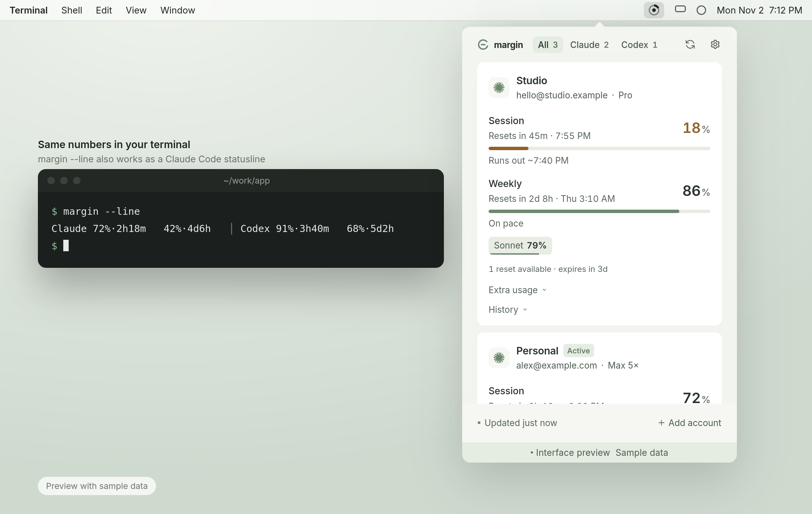
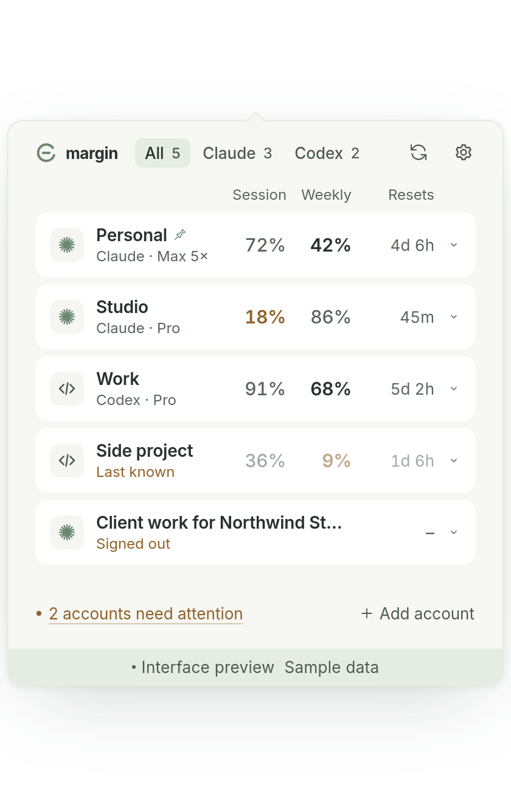
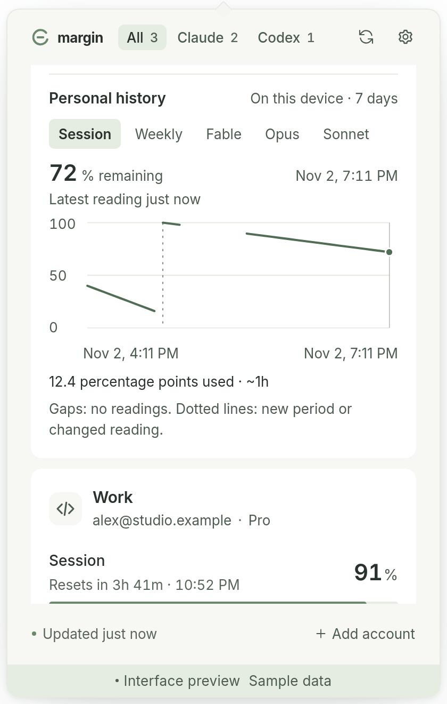

# Margin

**Claude Code and Codex usage in your menu bar.** Usage remaining and reset times for every account you use, in the macOS menu bar or the Windows system tray. Free and open source.

[](https://github.com/Abulkosim/margin/actions/workflows/ci.yml)
[](https://github.com/Abulkosim/margin/releases/latest)
[](https://github.com/Abulkosim/margin/releases)
[](docs/install.md)
[](LICENSE)
[](https://scorecard.dev/viewer/?uri=github.com/Abulkosim/margin)

[Download](https://github.com/Abulkosim/margin/releases/latest) · [Install](#install) · [Connect accounts](#connect-accounts) · [Command line](#command-line) · [Privacy](#privacy) · [Changelog](CHANGELOG.md)

<picture>
  <source media="(prefers-color-scheme: dark)" srcset="docs/images/hero-dark.png" />
  
</picture>

<sub>Interface preview with sample data.</sub>

## Install

1. Download **v0.9.0**: [macOS 12+ (Universal DMG)](https://github.com/Abulkosim/margin/releases/download/v0.9.0/Margin_0.9.0_universal.dmg) · [Windows x64 (Setup EXE)](https://github.com/Abulkosim/margin/releases/download/v0.9.0/Margin_0.9.0_x64-setup.exe) · [MSI](https://github.com/Abulkosim/margin/releases/download/v0.9.0/Margin_0.9.0_x64_en-US.msi)
2. Open it. Margin finds the Claude Code and Codex sign-ins already on your computer.

Builds are not signed with an Apple Developer ID or Windows publisher certificate, so the first launch shows a warning:

- **macOS.** Drag Margin to Applications and open it. On macOS 15 and later, when **“Margin” Not Opened** appears, click **Done**, then **System Settings → Privacy & Security → Open Anyway**. Margin lives in the menu bar, with no Dock icon.
- **Windows.** On **Windows protected your PC**, click **More info → Run anyway**. Smart App Control blocks unsigned apps.

Updates are signed and verified in the app. Margin checks daily and never installs on its own. Homebrew and winget are not available yet. Full guide with uninstall: [docs/install.md](docs/install.md).

## What it shows

- **Many accounts at once.** Finds existing Claude Code and Codex sign-ins, including separate configuration folders; add more in Settings.
- **Make active.** Switch which account Claude Code or Codex uses, after a confirmation, with a backup of the previous sign-in.
- **Session, weekly, and model limits.** Usage remaining, reset countdown and time, and a pace line: "On pace", or when usage runs out at the current rate.
- **Last-known values, labeled.** A failed request keeps the last reading with its age. Missing data stays unknown, never guessed.
- **Alerts.** Notifications at thresholds you choose (50–100%), when a limit is on pace to run out before it resets, when an account stops updating for 30 minutes, and optionally when a limit resets.

## Command line

`margin --line` prints the usage Margin last saved, without a network request:

```text
Claude 72%·2h18m   42%·4d6h   │ Codex 91%·3h40m   68%·5d2h
```

Use it as your Claude Code statusline. In `~/.claude/settings.json`:

```json
{
  "statusLine": {
    "type": "command",
    "command": "/Applications/Margin.app/Contents/MacOS/margin --line",
    "refreshInterval": 60
  }
}
```

`--all` prints one row per account and `--json` prints everything. Flags, Windows paths, colors and the JSON schema: [docs/cli.md](docs/cli.md).

## Why Margin

|  | Margin | [CodexBar](https://github.com/steipete/CodexBar) | [Claude Usage Tracker](https://github.com/hamed-elfayome/Claude-Usage-Tracker) | Claude Code `/usage`, Codex `/status` |
| --- | :-: | :-: | :-: | :-: |
| macOS | ✓ | ✓ | ✓ | ✓ |
| Windows | ✓ | – | – | ✓ |
| Multiple accounts | ✓ | ✓ | ✓ | – |
| Claude and Codex together | ✓ | ✓ | ✓ | – |
| OAuth only, no browser cookies | ✓ | – | – | ✓ |
| Updates while the CLI is idle | Until the token expires | ✓ | ✓ | – |
| Free, MIT | ✓ | ✓ | ✓ | – |

While the CLI is idle, usage refreshes until the token expires. Margin then shows the last reading until the CLI next runs.

CodexBar supports about 100 providers; pick it if you need more than Claude and Codex.

## Screenshots

| Compact overview | History |
| :-: | :-: |
| <picture><source media="(prefers-color-scheme: dark)" srcset="docs/images/compact-dark.png" /></picture> | <picture><source media="(prefers-color-scheme: dark)" srcset="docs/images/history-dark.png" /></picture> |

<sub>Interface previews with sample data.</sub>

## Connect accounts

Sign in through Claude Code or Codex first. Margin reads those OAuth credentials; API-key-only accounts are unsupported. Keep each account in its own configuration folder.

| Provider | Default credentials | Custom configuration |
| --- | --- | --- |
| Claude | `~/.claude/.credentials.json`; macOS `Claude Code-credentials` Keychain item as fallback | `CLAUDE_CONFIG_DIR` or an added folder; macOS `Claude Code-credentials-<suffix>` Keychain item |
| Codex | `~/.codex/auth.json` | `CODEX_HOME` or an added folder |

For a second Claude account, start Claude Code with its own folder and sign in:

```sh
CLAUDE_CONFIG_DIR=~/.claude-work claude
```

Margin finds home dotfolders containing `claude` or `codex`. For a folder elsewhere, use **Add account → Choose folder…**. Apps opened from Finder or the Start menu may not see terminal environment variables.

Idle means the token expired on disk: Margin shows the last reading and the command that gets a new one. Signed out? Margin shows the command to run. For a custom Codex account, run `codex login` with that `CODEX_HOME`. Claude usage needs the `user:profile` OAuth scope.

Provider usage endpoints are undocumented and may change. A displayed quota is the provider's reading, not a guarantee that the next request will be accepted.

## Verify a download

Compare checksums with `SHA256SUMS.txt`, and check the build attestation:

```sh
gh attestation verify Margin_<version>_universal.dmg --repo Abulkosim/margin
```

Both platforms: [docs/install.md](docs/install.md#verify-a-download).

## Privacy

Credentials and provider requests stay in Rust; the interface never receives tokens. Settings, last-known usage, and up to seven days of history are stored locally and can include account emails and folder paths.

Margin writes CLI sign-ins only when you confirm **Make active**, which swaps the default folder's sign-in with another folder's. The Codex desktop app shares the CLI's sign-in, so a Codex switch applies to it after you reopen it. It does not rotate CLI tokens, read browser cookies, or spend reset credits. No Margin account or hosted backend. Update checks contact GitHub Releases without sending credentials, identities, or usage.

Exact files, Keychain items, and hosts: [PRIVACY.md](PRIVACY.md). Vulnerabilities: [SECURITY.md](SECURITY.md).

## Develop

Run from source, preview with sample data, and run tests: [CONTRIBUTING.md](CONTRIBUTING.md).

## Contribute

[Report a bug](https://github.com/Abulkosim/margin/issues/new/choose) with the version, OS, display scaling, and steps. Redact account details; never attach tokens or credential files. Provider parsing changes need a fixture and a regression test.

The project stays focused on Claude and Codex. Inspired by [CodexBar](https://github.com/steipete/CodexBar). Independent, unaffiliated with Anthropic or OpenAI.

## License

[MIT](LICENSE)
